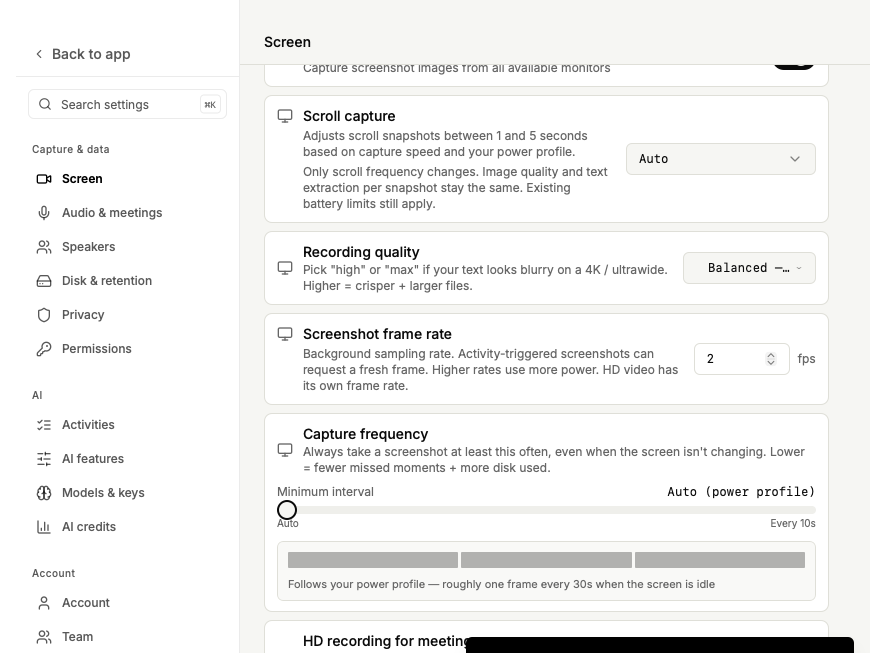

<!-- screenpipe — AI that knows everything you've seen, said, or heard -->
<!-- https://screenpipe.com -->

# Screenshot sampling: default and VM measurements

The default is **2 fps**. The setting controls background sampling and applies on the next screenshot without restarting recording. Saved screenshots keep their existing activity and capture-frequency rules. HD video has its own frame rate. Effective sampling is at least the configured idle recording rate (`ceil(1000 / idleCaptureIntervalMs)` fps). A faster idle pin raises sampling rather than slowing the promised recording cadence; live sampling edits below that minimum are rejected.

At roughly 3.5–4 screenshot requests per second, 24/30 fps did not provide a consistent fresh-request latency advantage that justifies making either the default. Two fps preserves the previous native preview cadence, with cost close to 1 fps in these VMs. Higher rates remain available.

## Moving-screen comparison

CPU values below are percentages of **one logical core**, measured within each VM. The VMs and workloads differ; this is a comparison between rates on each platform, not an OS ranking.

| Requested fps | Mac complete frames/s | Mac capture p95 ms | Mac WindowServer CPU/core % | Windows callbacks/s | Windows DWM CPU/core % | Windows fresh-request p95 ms |
|---:|---:|---:|---:|---:|---:|---:|
| 1 | 1.00 | 52.23 | 40.07 | 0.96 | 24.11 | 55.93 |
| 2 | 1.97 | 52.48 | 39.65 | 1.93 | 24.11 | 60.43 |
| 4 | 4.00 | 52.80 | 40.41 | 3.86 | 27.11 | 58.47 |
| 8 | 7.86 | 52.35 | 40.41 | 7.62 | 26.64 | 38.71 |
| 12 | 11.80 | 52.70 | 40.75 | 10.31 | 24.69 | — |
| 24 | 22.80 | 53.20 | 40.94 | 19.86 | 28.57 | 50.18 |
| 30 | 28.83 | 51.99 | 41.17 | 20.74 | 30.14 | 61.22 |

The Windows callback/CPU columns come from the original streaming matrix, which allowed cached readback. Its fresh latency column comes from the later request-correlated acquisition test; these are separate experiments. Native acquisition timestamps are not exposed by this Windows path, so latency is a software proxy.

## Mac: method, cost, and startup

macOS 26.6.2 (25G83), headless Orchard/Tart VirtualMac2,1, 12 vCPUs, 24 GiB, 1024×768. The optimized Swift harness exercises positive-selection ScreenCaptureKit and JPEG encoding, without AX walking, OCR, or disk writes. Static and 60 Hz synthetic moving fixtures each ran at 1/2/4/8/12/24/30 fps plus screenshot-only baseline, for 30 seconds at 4 requests/s. No other app capture, compilation, or desktop recording ran during the trials.

All **16 trials / 1,920 requests** completed, with zero failed trials or missed request scheduling deadlines. All 1,920 sample presentation times were distinct and at or after the corresponding request boundary. The two-fps moving trial used 9.92% of a core in the harness process; 24 fps used 10.59%. WindowServer used 39.65% versus 40.94%; replayd used 2.58% versus 3.17%. Peak process RSS was roughly 55–57 MiB.

Producer setup took 165–234 ms, first-frame arrival 172–250 ms, and teardown 3–16 ms. Those startup/stop costs are paid when the source changes, rather than on every screenshot. At 2 fps, fresh acquisition p95 was 48.03 ms static / 52.48 ms moving; including JPEG it was 55.75 / 57.00 ms. At 24 fps, acquisition was 48.12 / 53.20 ms and total 57.59 / 58.27 ms.

The fresh lookup in this API harness happens immediately after its request boundary; it had **zero cache hits** and used native snapshots. Production can use a background frame that arrives while current privacy checks run, but its cache-hit rate was not measured here. Earlier permissive cached-read microsecond timings are not fresh-capture timings. Screenshot-only was faster and cheaper than combining a producer with fresh snapshots in this isolated harness. The old product already had a separate 2 fps visual-preview producer, which the new source replaces; the screenshot-only baseline excludes that existing product cost. These results do not establish a general battery saving from persistent capture.

[Full static/moving matrix](macos/matrix-summary.csv), [per-request and aggregate data](macos/analysis.json), [raw process samples](macos/raw/), [native harness](macos/native-demand-harness.swift), [runner](macos/run-native-matrix.py). The runner uses the owned guest paths from this experiment and is intended for a disposable VM.

## Windows: method and freshness

Windows 11 Pro build 26100, 4-vCPU Hyper-V console VM, 1024×768, Microsoft Hyper-V Video 10.0.26100.1150. The actual WGC Rust source ran 28 static/moving streaming trials, forward and reverse, 30 seconds each at approximately 3.5 requests/s. All succeeded. Higher requested rates increased compositor work, and the VM delivered approximately 20.7 callbacks/s at a requested 30 fps during motion.

The follow-up fresh test completed **210/210 requests**, 35 each at 1/2/4/8/24/30 fps, with the existing 200 ms deadline and one GPU copy per request. Fresh requests temporarily remove the native background throttle, retain the existing request-generation guard, and restore the configured rate afterward. This prevents a low background rate from imposing a 500–1,000 ms wait. Native clock alignment and older unsupported Windows versions were not verified. The earlier transient-session comparison measured 14.6 ms setup, 39.1 ms first frame, and 6.8 ms close; see the Windows report for its separate method.

[Windows report and exact commands](windows/README.md), [raw matrix](windows/matrix-raw.json), [summary](windows/matrix-summary.csv).

## Real application acceptance

The supported native E2E builds used synthetic Standard-account fixtures. This tests capture behavior, rather than consumer authentication.

- Mac UI displayed the 2 fps default, accepted 4, and retained it after webview reload. Live 2/4/24/30 changes produced durable Safari JPEGs whose visible marker was verified with Vision OCR. In each 20-second moving phase, 4/3/3/3 screenshots were retained; static phases deduplicated to 0/0/1/0. Sampling fps is not stored-screenshot fps.
- Mac privacy: two retained 1024×768 images each contained 15,639 allowed cyan pixels and **zero forbidden magenta pixels across all pixels**. Controlled 60 Hz scene movement exercised rejection/reselection, then durable capture recovered. The actual originating cause and outcome survived the normal support collector/redactor after rotation.
- Mac HD: one clip each at 10 and 30 fps continued through screenshot sampling 2→24→4 with no chunk change. H.264 files contained 441 frames / 44.1 s and 1,377 frames / 45.9 s. Finalized DB markers were within decoded frame ranges (45 markers, maximum 440; 46 markers, maximum 1,350). Default window-privacy patterns still prevented HD chunks as before.
- Mac pause held the screenshot count at 53 through the pause; resume advanced it to 54. Windows native pause completed in 570 ms, held 6 frames for five seconds, then advanced to 7 after resume.
- Windows UI default/persistence and live changes passed. Seven retained privacy JPEGs preserved allowed cyan and had zero sampled forbidden magenta at four-pixel stride; this was a sampled check. Windows HD remains unsupported.

The Mac sharing-control fix uses the observed AXButton title `WindowSharingSessionButton`, native window ID, and PID. A window title or size alone never excludes content. Unknown windows remain content; unavailable classification suspends the optional producer and preserves same-policy native snapshots with diagnostic evidence. The visual probe shares the screenshot source, and the retired legacy preview was confirmed inactive. HD retains its separate owner.

The existing 750 ms app-switch settle remains unchanged. No retrospective history/ring buffer or event-time frame selection was added. The delay experiment did not establish that 750 ms is the necessary minimum.

## Validation

- Windows current library: 11 WGC units passed (3 desktop-only tests ignored); all 6 snapshot-writer units passed. Seven production-source hashes match the integration checkout. The actual Windows production logger output for an induced failure/recovery was replayed as a rotated app log through the Mac normal collector: HRESULT, FPS, ticks, cause and outcome survived; the fixture email was redacted. This is induced-failure evidence, not older-OS hardware acceptance.
- Mac `cargo test --profile debug-dev -p screenpipe-a11y sharing_control --lib`: 1 passed.
- Mac `cargo test --profile debug-dev -p screenpipe-screen screenshot_privacy --lib`: 38 passed, including source cancellation, privacy fences, reselection, and snapshot-only fallback heartbeat. Earlier full screen-crate run: 244 passed, 3 ignored, including duplicate-timestamp durable writes.
- Mac supported queued E2E app build passed; bindings generation/check, component test (1), typecheck, and config tests (2) passed.
- `bun run test:tauri induced_wgc_interval_failure_and_recovery_reach_normal_redacted_collector -- --nocapture`: 1 main-binary test passed on Mac. The Windows wrapper encountered its existing build-script file lock; no raw-Tauri fallback was used.
- `bun test evals/coding-agent/graders/capture-cadence.test.js`: 4 passed. Its calibration: 10 passed. The adapter now mocks the additional visual cards and shared default without changing grading assertions.
- Additional unchanged settings-restart/privacy graders could not load their pre-existing stale adapters (`invalidateEnterpriseBuildStatus` / `gt-react`); their unrelated product modules were unchanged.

Before: fixed native preview rate, event-only snapshot acquisition. After: live configurable background sampling, a policy-validated native cache, and fresh same-policy demand fallback, with separate HD cadence.

