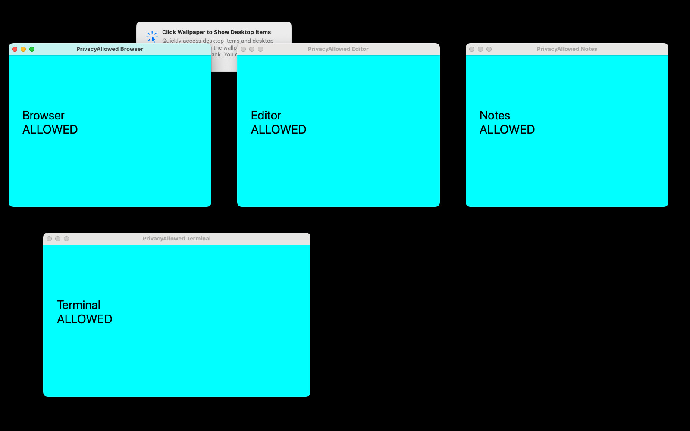
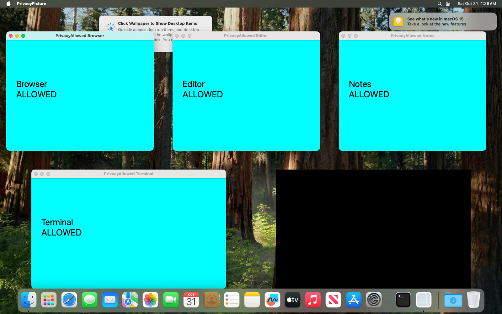
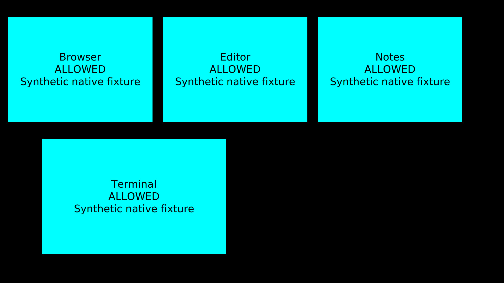
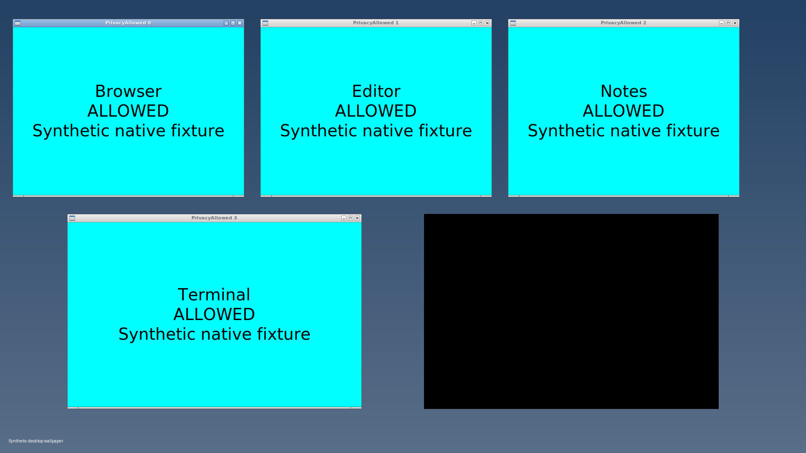

# Selective window redaction: native validation

<!-- doc-covers: crates/screenpipe-screen/src/screenshot_privacy, crates/screenpipe-screen/src/wgc_capture.rs, crates/screenpipe-engine/src/event_driven_capture.rs -->
<!-- doc-verified: 24e1403044156e4c1d3462c773a9d8de47617818 -->

Window filters keep a monitor-sized screenshot. Excluded visible regions are black; allowed windows, desktop context, stacking and native pixel density are retained. There is no focused-window setting or automatic crop. Explicit include rules remain strict.

The fixtures below are native application windows on isolated cloud guests. Cyan is allowed content; magenta is the excluded marker. Every accepted probe capture was written through `SnapshotWriter`, reopened as a JPEG, and checked for the marker. Raw captures with filters disabled are positive controls. Pixel assertions also require useful allowed content, correct stacking and monitor dimensions, so an empty black image cannot pass as a successful ordinary capture.

## Native recordings

[Windows native matrix, optimized comparison and remaining limits](windows/README.md).

Each narrated review retains the full desktop recording on the left and shows a saved screenshot sample from each scene on the right. Captions identify the policy and scenario. These recordings demonstrate native test fixtures, not customer footage.

- [Windows final release recorder session](windows/videos/recorder-session-review.mp4)
- [Windows transparency checks](windows/videos/transparency-review.mp4) (development build, correctness evidence only)
- [macOS native session](macos/videos/native-session-review.mp4)
- [Linux/X11 native session](linux/videos/native-session-review.mp4)
- [macOS complete recorder session](macos/videos/recorder-session-review.mp4)
- [Linux complete recorder session](linux/videos/recorder-session-review.mp4)
- [macOS focused-exclusion excerpt](macos/videos/excluded-focus-review.mp4)
- [Linux focused-exclusion excerpt](linux/videos/excluded-focus-review.mp4)

## Before and after

The same native five-window scene captured with the previous filtered backend (`3bb684b71567885bef406bfc3186f9da1c25a3af`) and this implementation. These are actual stored screenshots from the clean comparison runs.

| OS | Previous filtered backend | Selective redaction |
| --- | --- | --- |
| Windows |  |  |
| macOS |  |  |
| Linux/X11 |  |  |

## Stable scene matrix

Each linked macOS and Linux scenario made 12 capture attempts. The `five-none` row deliberately contains the magenta marker to verify the detector. All other linked stable rows saved 12/12 with no excluded marker. The no-match policy row is independently checked by its image assertions.

| Scenario | Expected output | macOS | Linux/X11 |
| --- | --- | --- | --- |
| Filters disabled | Full desktop; magenta marker present | [Saved](macos/cases/five-none/capture/frame-0.jpg) · [Desktop](macos/cases/five-none/desktop.jpg) | [Saved](linux/cases/five-none/capture/frame-0.jpg) · [Desktop](linux/cases/five-none/desktop.jpg) |
| Five windows, one excluded | Four allowed windows + desktop, only excluded region black | [Saved](macos/cases/five-exclude/capture/frame-0.jpg) · [Desktop](macos/cases/five-exclude/desktop.jpg) | [Saved](linux/cases/five-exclude/capture/frame-0.jpg) · [Desktop](linux/cases/five-exclude/desktop.jpg) |
| Explicit include list | Only included windows; excluded and unlisted content black | [Saved](macos/cases/five-include/capture/frame-0.jpg) · [Desktop](macos/cases/five-include/desktop.jpg) | [Saved](linux/cases/five-include/capture/frame-0.jpg) · [Desktop](linux/cases/five-include/desktop.jpg) |
| No include match | Monitor-sized black output; recorder may suppress empty image | [Saved](macos/cases/five-empty/capture/frame-0.jpg) · [Desktop](macos/cases/five-empty/desktop.jpg) | [Saved](linux/cases/five-empty/capture/frame-0.jpg) · [Desktop](linux/cases/five-empty/desktop.jpg) |
| No excluded window visible | Full desktop context | [Saved](macos/cases/no_excluded-exclude/capture/frame-0.jpg) · [Desktop](macos/cases/no_excluded-exclude/desktop.jpg) | [Saved](linux/cases/no_excluded-exclude/capture/frame-0.jpg) · [Desktop](linux/cases/no_excluded-exclude/desktop.jpg) |
| Filter matches nothing | Full desktop context | [Saved](macos/cases/no_excluded-nomatch/capture/frame-0.jpg) · [Desktop](macos/cases/no_excluded-nomatch/desktop.jpg) | [Saved](linux/cases/no_excluded-nomatch/capture/frame-0.jpg) · [Desktop](linux/cases/no_excluded-nomatch/desktop.jpg) |
| Excluded window minimized | Allowed desktop; mirrored private preview must not leak | [Saved](macos/cases/minimized-exclude/capture/frame-0.jpg) · [Desktop](macos/cases/minimized-exclude/desktop.jpg) | [Saved](linux/cases/minimized-exclude/capture/frame-0.jpg) · [Desktop](linux/cases/minimized-exclude/desktop.jpg) |
| Excluded window off screen | No unrelated blackout | [Saved](macos/cases/offscreen-exclude/capture/frame-0.jpg) · [Desktop](macos/cases/offscreen-exclude/desktop.jpg) | [Saved](linux/cases/offscreen-exclude/capture/frame-0.jpg) · [Desktop](linux/cases/offscreen-exclude/desktop.jpg) |
| Excluded window in front | Black hides lower allowed pixels | [Saved](macos/cases/excluded_front-exclude/capture/frame-0.jpg) · [Desktop](macos/cases/excluded_front-exclude/desktop.jpg) | [Saved](linux/cases/excluded_front-exclude/capture/frame-0.jpg) · [Desktop](linux/cases/excluded_front-exclude/desktop.jpg) |
| Allowed window in front | Allowed foreground remains visible over black | [Saved](macos/cases/excluded_behind-exclude/capture/frame-0.jpg) · [Desktop](macos/cases/excluded_behind-exclude/desktop.jpg) | [Saved](linux/cases/excluded_behind-exclude/capture/frame-0.jpg) · [Desktop](linux/cases/excluded_behind-exclude/desktop.jpg) |
| Transparent allowed foreground | Native premultiplied alpha blends over black | [Saved](macos/cases/transparent_front-exclude/capture/frame-0.jpg) · [Desktop](macos/cases/transparent_front-exclude/desktop.jpg) | [Saved](linux/cases/transparent_front-exclude/capture/frame-0.jpg) · [Desktop](linux/cases/transparent_front-exclude/desktop.jpg) |
| Tiny allowed foreground | Useful small window survives heavy black padding | [Saved](macos/cases/small-exclude/capture/frame-0.jpg) · [Desktop](macos/cases/small-exclude/desktop.jpg) | [Saved](linux/cases/small-exclude/capture/frame-0.jpg) · [Desktop](linux/cases/small-exclude/desktop.jpg) |
| Known application, blank title | App identity determines policy; title alone is not identity | [Saved](macos/cases/blank_title-exclude/capture/frame-0.jpg) · [Desktop](macos/cases/blank_title-exclude/desktop.jpg) | [Saved](linux/cases/blank_title-exclude/capture/frame-0.jpg) · [Desktop](linux/cases/blank_title-exclude/desktop.jpg) |
| Every application window excluded | Application regions black; independently allowed shell remains | [Saved](macos/cases/all_excluded-exclude/capture/frame-0.jpg) · [Desktop](macos/cases/all_excluded-exclude/desktop.jpg) | [Saved](linux/cases/all_excluded-exclude/capture/frame-0.jpg) · [Desktop](linux/cases/all_excluded-exclude/desktop.jpg) |
| Window crosses display boundary | Mask clipped to the capture display | [Saved](macos/cases/spanning-exclude/capture/frame-0.jpg) · [Desktop](macos/cases/spanning-exclude/desktop.jpg) | [Saved](linux/cases/spanning-exclude/capture/frame-0.jpg) · [Desktop](linux/cases/spanning-exclude/desktop.jpg) |
| Excluded window completely covered | Opaque allowed foreground preserved | [Saved](macos/cases/fully_occluded-exclude/capture/frame-0.jpg) · [Desktop](macos/cases/fully_occluded-exclude/desktop.jpg) | [Saved](linux/cases/fully_occluded-exclude/capture/frame-0.jpg) · [Desktop](linux/cases/fully_occluded-exclude/desktop.jpg) |

## Additional validation

- macOS: two displays, a negative monitor origin, real 2× Retina output (2560×1440), and explicit width cap. Native topology receipts and positive pixel checks accompany the samples.
- macOS Mission Control: 12/12 accepted captures with no excluded marker; the saved sample retains all four allowed windows. Minimized Dock previews are inspected through native accessibility metadata; unavailable or ambiguous inspection masks Dock coverage conservatively.
- Linux: two native RandR outputs, excluded window on either output, spanning window and allowed foreground on the second display. 14 coordinate/dimension assertions passed.
- Linux rapid creation/movement/destruction: 400 attempts during 2,349 native popup cycles. 399 were withheld because the scene changed, one saved with no excluded marker, then 12/12 recovery captures succeeded. This is a fail-closed stress result, not a claim of uninterrupted recording during extreme churn.
- macOS popup churn: 400 attempts saved 32 safe frames and withheld 368; all accepted PNGs/JPEGs had no excluded marker, followed by 12 successful recovery frames.
- Linux Wayland refusal: three filtered attempts were rejected with an explicit unsupported-backend error. No raw monitor fallback was used. Native Wayland selective capture is not implemented by this PR.
- Simultaneous two-display recorder: Linux persisted 50 indexed frames on each monitor over 60 seconds; macOS persisted 45 and 22. All 101 Linux and 65 macOS stored JPEGs retained allowed content and contained no excluded marker; production database checks passed. These counts include startup/shutdown timing, so indexed rows and JPEG counts can differ. This is a continued-recording check, not an equal-framerate guarantee.
- Transparency controls: changing only the excluded background from magenta to orange changes the raw screenshot but leaves filtered overlap pixels unchanged. Separate ROI checks require the expected 55% cyan-over-black value (approximately RGB 0,140,140), catching both accidental opacity and double attenuation. macOS and Linux passed both checks.
- Recorder path: captures are also tested through the real engine and durable index, including a tiny allowed window and a static desktop. Stored-JPEG checks and production database verification are retained separately from probe results.

Windows final release recorder persisted 19 excluded-focus frames with empty focused identity/text/reference fields and 17 strict-include frames. A separate 63.64-second default-cadence run stored four frames without a repeated visual-change loop. All 40 actual JPEGs passed independent full-image audits. Three isolated synthetic policy tests (URL policy, DRM policy and incognito title) each stored zero images and zero rows over more than 25 seconds; all production database checks passed. These are conservative policy-gate tests, not protected-media playback or browser URL extraction tests. Full receipts and limitations are in the Windows report.

## Performance and source identity

These measurements include a real native capture backend, not mocked OS APIs. Capture latency excludes the later JPEG write/reopen check; process CPU and RSS include those operations. Each probe pauses 100 ms between attempts. Warmup is 20 frames. CPU percentages are relative to one core and exclude the separate desktop compositor.

| Native guest | Candidate filtered median / p95 | Previous filtered backend median / p95 | Raw control median / p95 | Stability/resources |
| --- | --- | --- | --- | --- |
| Windows 11 Pro 24H2, 1024×768, Hyper-V Video | 463.96 / 526.83 ms | 594.86 / 664.38 ms | Not part of matched run | 119/120 candidate saved; one scene-change rejection; baseline 120/120; candidate peak RSS 42.35 MiB, peak handles 273 |
| Ubuntu 24.04, X11, 1920×1080, 16 vCPU / 32 GB | 39.36 / 41.95 ms | 13.25 / 15.83 ms | 10.61 / 11.01 ms | 620/620 saved; RSS 21–45 MiB, final 21; 9–10 file descriptors; 46.7% one-core CPU |
| macOS 15.7.7 (24G720), 1600×1000, 8 vCPU / 16 GB | 114.81 / 122.04 ms | 66.67 / 69.09 ms | 44.27 / 49.48 ms | 620/620 saved; 1,800-frame extension also saved all frames; RSS plateau around 202 MiB |

Windows used the same release probe bytes for both backends, with a separate 20-frame warmup process followed by a 120-attempt measured process. Capture median and nearest-rank p95 are recomputed from accepted frames. Candidate frame zero was withheld because the scene changed; every saved frame was 1024×768 with no excluded marker. Total measured probe CPU time increased from 9.094 to 10.234 seconds (12.5%), while peak handles fell from 984 to 273. An earlier release raw control is retained separately as historical evidence; it is not the matched baseline.

Linux and macOS clean comparisons use the same probe driver revision for both variants, with the original `3bb684b71567885bef406bfc3186f9da1c25a3af` filtered backend. Both filtered comparisons in the table use sequential runs of 140 attempts each (20 warmup, 120 measured) after compilation finished; both saved every frame with no excluded marker. An earlier 620-frame candidate run measured 97.35 / 104.78 ms. An earlier original-backend comparison used 1,800 attempts, but a release compiler overlapped it, so that older result is not an isolated benchmark. The macOS 1,800-frame candidate extension also overlapped compilation and is used for memory stability, not an uncontended latency comparison. Its minute RSS medians were 189.66, 202.05, 202.12, 202.12, 202.12, 202.12, 202.12 MiB. The original backend plateaued around 156–161 MiB.

The change has a measurable cost. Linux filtered capture adds about 26 ms per frame in this fixture. The clean macOS comparison adds about 48 ms per frame. The final Linux recorder used a median 11.5% of one core and peaked at 128 MiB RSS; it saved 20 excluded-focus frames over 23.16 observed seconds. The final macOS recorder used a median 4.7% of one core and peaked at 347 MiB RSS; it saved 19 excluded-focus frames over 23.46 observed seconds. The explicit 1-second idle interval is a delay between work, not a guaranteed 1 FPS output rate. The short macOS run reached 190 MiB RSS; the longer run reached a stable observed plateau rather than proving absence of all leaks. These bounded runs do not establish battery impact, all-day stability, or equivalent performance on other GPUs and window counts. Windows release capture latency decreased in its matched fixture, while total probe CPU time increased. Windows resource recovery and recorder results are documented in its native evidence report.

## Capture implementation

macOS uses ScreenCaptureKit with positively selected surfaces, then masks excluded geometry and restores isolated allowed foreground pixels in stacking order. Linux/X11 composes isolated XComposite window pixmaps over verified wallpaper. Windows composes fresh isolated WGC window surfaces in native stacking order. All three retain monitor dimensions and recheck the native scene before accepting a filtered frame; failure never switches to an unfiltered monitor screenshot. Unknown surfaces are masked or cause the frame to be withheld.

The engine keeps verified desktop pixels when an explicitly excluded window has focus, while storing no focused identity, OCR, accessibility text, URL, document path or reused-element reference. Stricter incognito, URL and DRM gates retain their rejection behavior.

## Practical limits

- A filtered recorder frame whose focused privacy metadata is rejected, unavailable or busy is withheld. A verified explicitly excluded focus can retain the allowed desktop with all focused identity, OCR, AX, URL, document and reused-element fields empty. URL and DRM policies do not use this pixels-only exception.
- An unstable or unverifiable scene withholds the screenshot instead of falling back to raw pixels. Frequent window churn can therefore create capture gaps.
- These are window policies, not semantic redaction inside arbitrary allowed applications. Content copied or streamed into another allowed application's own content remains governed by that application's policy.
- Native snapshots before and after capture detect observed identity, order, geometry and policy changes. They are not an atomic OS transaction; macOS/Windows title changes that return to their original state entirely inside a capture remain a limitation. X11 additionally observes native structure/policy events.
- Windows shell previews are conservatively masked when their source identity cannot be verified, including some previews of otherwise allowed windows. Two native taskbar hover attempts did not produce a visible thumbnail, so actual thumbnail coverage remains unverified. Ordinary allowed-window preservation is tested separately.
- Windows distinct-target churn created 12 allowed windows over about 24 seconds, followed by 39.53 seconds of static-capture recovery: 61 captures accepted, 9 withheld, no excluded marker. Five rejections detected scene changes; four reported native frame-pool invalid-parameter errors during target destruction. Recovery RSS fell from 40,755,200 to 33,439,744 bytes, but sampled handles rose from 273 to 285 (+12); whole-run peaks were 296 handles and 41,291,776 bytes. Native Closed/cache-eviction events were not directly instrumented. The native item cache holds at most eight targets; this run does not establish bounded handle use for a desktop with more than eight simultaneously captured allowed targets. This is a remaining resource limit, not proof of leak freedom.
- Ordinary excluded windows are masked to their native rectangular bounds. Transparent areas within those bounds can also be black; this is conservative window redaction rather than pixel-level semantic segmentation.
- Unknown surfaces and unavailable shell metadata can cause conservative black regions. macOS requires ScreenCaptureKit screenshot support (macOS 14+); older systems fail closed for this filtered path.
- Image previews are JPEGs to keep the review bundle bounded. Capture previews use the original stored JPEG where available; desktop reference images are JPEG encodings of the native screenshot. Original PNG dimensions and hashes are in `original-image-sources.json`. Probe logs retain the actual durable pixel checks. `sha256.json` covers the review assets. Text-only review logs have normalized line endings and trailing whitespace; `text-normalization.json` retains original and normalized hashes. Binary images and recordings remain unchanged.

## Local checks

| Command | Result |
| --- | --- |
| `cargo test -p screenpipe-engine --lib event_driven_capture::tests` | 101 passed |
| `cargo test -p screenpipe-screen --lib screenshot_privacy` | 10 passed on macOS; Windows-only tests are in its report |
| Native Windows: `cargo test -p screenpipe-screen --profile debug-dev screenshot_privacy::windows::tests -- --nocapture` | 5 passed, 1 live-console unit ignored; native release fixture checks retained |
| `cargo test -p screenpipe-engine --lib cli::tests` | 50 passed |
| `cargo test -p screenpipe-config --lib` | 26 passed |
| `bun run typecheck` from `apps/screenpipe-app-tauri` | passed |
| `bun run coverage:all:check` from `apps/screenpipe-app-tauri` | passed after coverage regeneration |

Logs are in [local-tests](local-tests/). Platform-targeted runtime source hashes and binary hashes are in each `final-native/source-hashes.json`; the [final source manifest](source-manifest.json) identifies the reviewed repository tree. The final shared probe adds per-stage write/read timings and Windows fixture modes. Its final bytes were separately compiled and smoke-tested on macOS and Linux; production runtime hashes are unchanged from their full acceptance runs. Probe revision receipts are in `probe-final-smoke/acceptance.json`. Local checks complement the native guest runs above.

## Reproduction

The native probe is `crates/screenpipe-screen/examples/screenshot_redaction_probe.rs`. Run it only on an isolated synthetic desktop:

```sh
cargo run -p screenpipe-screen --release --example screenshot_redaction_probe -- OUT exclude MONITOR_ID 620 100
```

Use `none` for the positive control, `include` for the strict include policy, `empty` for no matching include, and optional `MAX_WIDTH` for the macOS resolution-cap test. Fixture and acceptance drivers are in [harness](harness/). The macOS virtual-display helper is the repository's `scripts/native-test-fixtures/macos/display-fixture.mm` and requires `SCREENPIPE_ISOLATED_VM_TEST=1`. Native Windows results use their own verified console-session harness.
