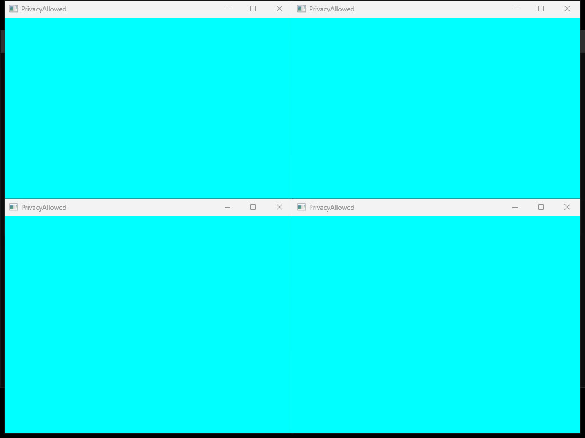
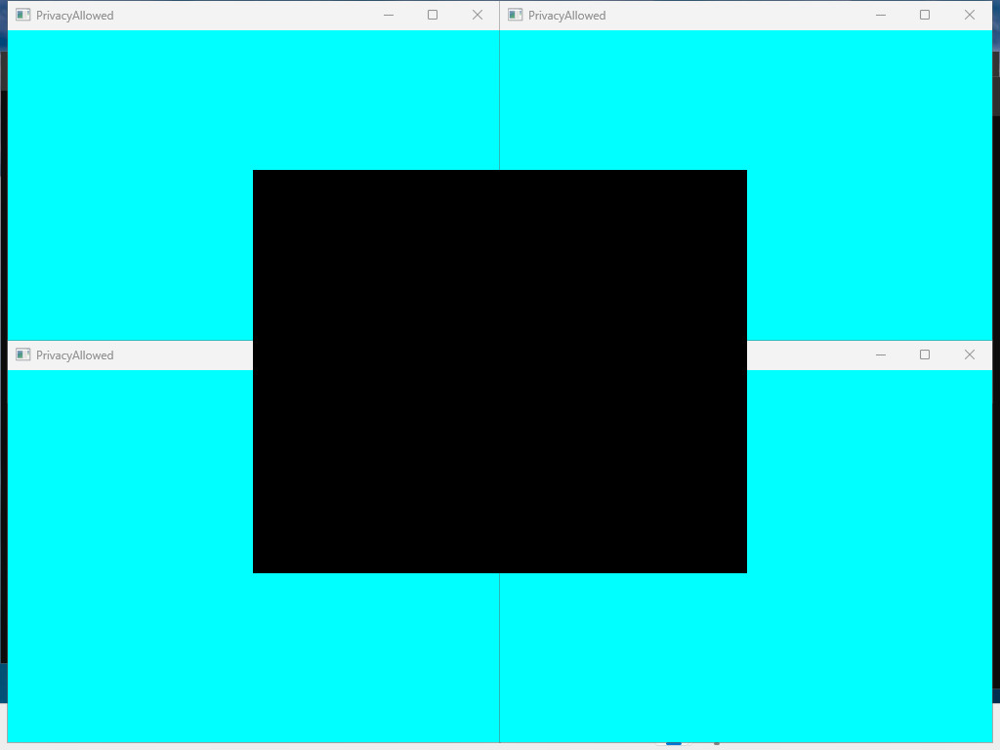

<!-- screenpipe — AI that knows everything you've seen, said, or heard -->
<!-- https://screenpipe.com -->
<!-- doc-covers: crates/screenpipe-screen/src/screenshot_privacy/windows.rs, crates/screenpipe-screen/src/wgc_capture.rs, crates/screenpipe-engine/src/event_driven_capture.rs -->
<!-- doc-verified: 24e1403044156e4c1d3462c773a9d8de47617818 -->

# Windows native selective-redaction evidence

The final Windows backend keeps full monitor dimensions, composites isolated allowed surfaces in native z-order, and paints excluded visible regions black. It preserves allowed foreground overlap and applies native global opacity once. Unknown or changing scenes fail closed. The implementation does not add a focused-window setting or crop.

Native environment: Windows 11 Pro 24H2, build 26100.9168, Microsoft Hyper-V Video driver 10.0.26100.1150, DWM/Explorer in the interactive console session, one 1024×768 Generic PnP display. This is one Azure virtual hardware configuration, not proof across every Windows version, GPU or compositor.

## Source and build identity

Final production source matches parent commit `24e1403044156e4c1d3462c773a9d8de47617818`. The native worker's branch history differs because it integrated parent files before the final parent rebase; exact source hashes link the tested production code.

| File | SHA256 |
|---|---|
| `screenshot_privacy/windows.rs` | `39e046222ddf19e354619d42adfcaae2cb7149f0b413edbc5745ceee80bd5b6d` |
| `wgc_capture.rs` | `aae27ee016b32fe65f306e5b14391aa47f32c9b25f4ae694a08f38a4dd3e69ab` |
| `event_driven_capture.rs` | `307749f49ed27be32a39fca91569ccee3d2a22b16a50b9b76943c5b33487acf9` |
| Shared probe | `07e04cbbecb0aca12aa6e8f89942304e64c695dca48b9606deb076138469d958` |
| Windows fixture | `cb2e4d18383bbab3cd3101fda5512e17638453d14c4991cfe0b8dfc3444d2bca` |

The final native working files use LF. Five narrow privacy unit tests passed, including the two global-opacity regressions; one live-console unit test was intentionally ignored because native fixture/probe checks exercise that behavior. Exact native unit command: `cargo test -p screenpipe-screen --profile debug-dev screenshot_privacy::windows::tests -- --nocapture` with `CARGO_TARGET_DIR=C:\spdev`, exit 0. Unit tests used `debug-dev` only. Final probes and the final recorder use explicit `--release`; build receipts record source and executable hashes and verify copied binaries against the release output path.

## Final release screen checks

| Native case | Observed output and assertion | Coverage |
|---|---|---|
| Five windows, one excluded above the others | Full 1024×768, black excluded region; a separate visible ROI from each of four allowed windows retained; no excluded marker in PNG/JPEG | Final release targeted recheck |
| Strict title include list | Four allowed ROIs retained, excluded marker absent | Final release targeted recheck |
| Genuine blank title, app include policy | Resolved allowed app remains visible without a caption | Final release targeted recheck; an initial renamed-executable harness attempt was invalid and excluded |
| Configured exclude pattern with no match | Allowed content retained across the screen | Final release targeted recheck |
| No visible excluded window | Allowed content retained across the screen | Final release targeted recheck |
| Excluded window fully occluded | Allowed foreground preserved | Final release targeted recheck |
| Excluded window minimized | Allowed content retained; no excluded marker | Final release targeted recheck |
| Half-transparent allowed foreground over excluded content | All 102,000 overlap pixels are RGB(0,128,128), preserving 50% cyan over black | Final release numeric ROI |
| Excluded underlay changes magenta→red | Raw overlap changes from RGB(127,128,255) to (127,128,128); filtered ROI is byte-identical across backgrounds | Final release raw positive controls and filtered A/B |
| Allowed→excluded→allowed title transition | 192,024 allowed pixels before and after; zero while blocked | Prior guards3 native correctness run; same production logic, debug-dev profile |

The seven final stable scene rechecks use one frame per case, alongside the longer earlier native matrix. They do not pretend to be a second full matrix. The first release A/B attempt used the ordinary comparison scene, not the half-transparent fixture; only `alpha-ab-release-acceptance/` is acceptance evidence.

## Representative stored JPEGs

These are actual SnapshotWriter JPEGs, copied without re-encoding. Their original saved path suffixes and hashes are in [the image manifest](saved-images/provenance.json).

| Original filtered backend | Final release candidate |
|---|---|
|  |  |

[Five windows, one excluded](saved-images/normal-five-windows.jpg) · [Transparent foreground over excluded region](saved-images/alpha-filtered.jpg)

## Clean optimized comparison

Both binaries use the same frozen probe, compiler, machine, release profile and five-window fixture scene. The baseline uses the original filtered backend at `3bb684b71567885bef406bfc3186f9da1c25a3af`, with no production baseline changes. Each side runs a separate 20-frame warmup process, then a fresh 120-frame measured process. No compiler was active during measurement. This is not a same-process warmup discard.

| Metric | Original filtered baseline | Candidate |
|---|---:|---:|
| Saved / attempted | 120 / 120 | 119 / 120 |
| Excluded-marker leaks | 0 | 0 |
| Capture mean | 597.52 ms | 468.06 ms |
| Capture median | 594.86 ms | 463.96 ms |
| Capture p95 | 664.38 ms | 526.83 ms |
| JPEG write median / p95 | 22.04 / 24.88 ms | 22.72 / 25.18 ms |
| Saved-image read median / p95 | 10.03 / 10.53 ms | 10.08 / 11.39 ms |
| Probe CPU time | 9.09375 s | 10.234375 s |
| Peak RSS | 45,891,584 bytes | 44,404,736 bytes |
| Peak / final sampled handles | 984 / 975 | 273 / 269 |

The candidate's first attempted frame was withheld with `window scene changed during privacy capture`; all saved frames were 1024×768. Capture mean decreased 21.67%, while measured process CPU increased 12.54%. These results do not establish zero performance cost. The original baseline's sampled handle growth is substantial; static candidate bounds do not prove behavior under distinct-window churn.

`comparison-release/recomputed-summary.json` computes standard median and nearest-rank p95 from accepted frames. The native summary is preserved as a raw receipt, but used a lower percentile index. CPU/RSS/handle samples include process startup. Earlier stage2's 600-frame release run measured an older candidate against an unfiltered raw control; it is separate correctness/stability evidence, not the original-filtered comparison. Guards3's accidental debug-dev comparison is excluded from performance conclusions.

## Final recorder acceptance

[Watch the final release recorder session](videos/recorder-session-review.mp4), with native desktop footage, actual stored JPEG samples, narration and captions. [Video provenance](recorder-video-manifest.json).

The frozen release recorder saved 19 excluded-focused JPEGs with 19 matching canonical index rows. Every matched row omits focused identity, text and references and sets focused false. Strict include saved 17 useful JPEGs. Production `db check` exited 0. Native initial pixel checks sampled the excluded region. An independent host audit then scanned every pixel of all 36 stored JPEGs: zero excluded-marker pixels, more than 1,000 allowed cyan pixels per image, and every image 1024×768. The [full-image receipt](recorder-release/full-jpeg-audit.json) and [audit script](recorder-release/audit-windows-recorder-jpegs.py) are included. These two runs explicitly used a 1-second idle interval and disabled visual checks, so they establish persistence and metadata behavior, not default quiet cadence.

[Actual excluded-focused recorder JPEG](saved-images/recorder-excluded-focus.jpg) · [Actual strict-include recorder JPEG](saved-images/recorder-strict-include.jpg) · [Persistence and metadata receipt](recorder-release/final-recorder-acceptance.json) · [Strict include receipt](recorder-release/strictinclude-recorder-acceptance.json)

The same frozen release binary then passed three isolated negative cases: excluded focus with URL policy, excluded focus with DRM pause policy, and a `PrivacyBlocked Incognito` focused title. Each ran more than 25 seconds with a 1-second idle interval and saved zero JPEGs and zero canonical frame rows. Production `db check` exited 0 for all three. These are synthetic policy-gate tests, not actual protected-video playback or browser URL extraction tests. Exact commands, foreground identities, native exits and empty row arrays are in [the gate receipts](recorder-gates/case-events.json). Info-level logs record startup configuration and capture opportunities but do not expose each rejection reason.

The valid quiet-static run omitted both visual-check and idle-interval overrides. It lasted 63.637 seconds and stored four full-monitor frames: manual, app-switch, one startup visual-change, then one idle capture 30.45 seconds later. There was no repeated visual-change loop. All four index rows contain no focused identity/text/references. An independent [full-image audit](recorder-gates/cadence-full-jpeg-audit.json) passed all four stored JPEGs: full 1024×768 dimensions, useful allowed pixels and zero excluded-marker pixels. Production DB check exited 0. Six same-process resource samples span 50.065 seconds: CPU delta 0.359375 seconds, RSS 88,121,344→70,336,512 bytes, and handles 856→852 (range 852–858). This is a short observed cadence check, not a whole-process performance guarantee. [Cadence receipt](recorder-gates/cadence-acceptance.json), [samples](recorder-gates/cadence-valid-resource-samples.json), [stored JPEG](saved-images/recorder-default-cadence.jpg).

An earlier 44-second cadence attempt was stopped prematurely by the validator and excluded from acceptance. Raw native elapsed fields truncated some fractional start seconds; [recomputed timings](recorder-gates/recomputed-case-timing.json) use the preserved ISO timestamps and final log write time. The final wrapper's export failed because the worker used the previous results folder; the completed native receipts and JPEGs were recovered by a read-only export and verified by SHA. No production source or binary changed.

The distinct-target release probe attempted 70 frames over 63.660 seconds: 61 accepted, 9 withheld, zero excluded-marker leaks. Twelve allowed targets were created over about 24 seconds, followed by 39.533 seconds of static-capture recovery sampling in the same process. First active handles 273 increased to 285 at the last recovery sample; RSS decreased from 40,755,200 to 33,439,744 bytes. Whole-run peaks were 296 handles and 41,291,776 bytes. Five withheld captures detected scene changes and four encountered native CreateFreeThreaded invalid-parameter errors during target churn. Engine compilation was active, so this lane is not a clean latency benchmark. Callback-level Closed/eviction events were not instrumented; exercising more than eight distinct targets is not direct proof of every callback. Residual handle growth remains a limitation.

Shell-preview native coverage is unavailable. UI Automation identified the visible taskbar button at (680,720) with 44×48 bounds, but two real hover attempts did not materialize a thumbnail window. Raw captures contained the excluded source window, but not an excluded thumbnail. This is not a passing preview privacy test; no further preview retries were performed.

## Limits

Native multi-monitor, HiDPI, other Windows builds/GPUs, and all per-pixel layered-window variants are not established by this single-display guest. Known Explorer thumbnail/switcher surfaces are conservatively blocked when source-window ownership cannot be verified, including potentially allowed previews. That can black more than the ordinary excluded app rectangle. A live preview test needs an enumerated visible preview and a raw excluded-thumbnail positive control; an absent preview is not a pass.

Whole-scene before/after checks withhold detected geometry, identity, title, opacity and z-order changes. They cannot establish that an intermediate state which returns identically between snapshots never occurred. Final recorder negatives and target-churn resource limits must be read alongside the visual checks; neither zero marker counts nor a static screenshot alone establishes universal privacy or leak freedom.
